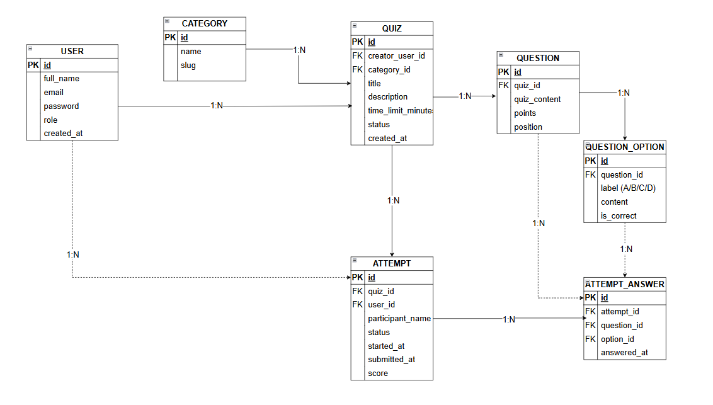
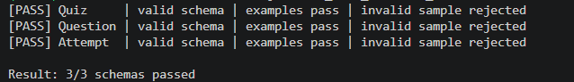

# Bài 1 – Resource Design: Hệ thống trắc nghiệm online

## Yêu cầu bài tập

- Domain: **Trắc nghiệm online**.
- 3 resource chính: `Quiz`, `Question`, `Attempt`.
- ERD: 1 Quiz có nhiều Question và nhiều Attempt.
- Danh sách **16 endpoint REST**.
- JSON Schema (Draft 2020-12) cho từng resource chính.

## Danh sách 16 endpoint

| Method | URL | Mục đích |
|---|---|---|
| GET | `/api/v1/quizzes` | Danh sách đề thi |
| POST | `/api/v1/quizzes` | Tạo đề thi |
| GET | `/api/v1/quizzes/{quizId}` | Xem đề thi |
| PATCH | `/api/v1/quizzes/{quizId}` | Sửa đề thi |
| DELETE | `/api/v1/quizzes/{quizId}` | Xóa đề thi |
| GET | `/api/v1/quizzes/{quizId}/questions` | Danh sách câu hỏi theo đề |
| POST | `/api/v1/quizzes/{quizId}/questions` | Thêm câu hỏi vào đề |
| GET | `/api/v1/questions/{questionId}` | Xem chi tiết câu hỏi |
| PATCH | `/api/v1/questions/{questionId}` | Sửa câu hỏi |
| DELETE | `/api/v1/questions/{questionId}` | Xóa câu hỏi |
| GET | `/api/v1/quizzes/{quizId}/attempts` | Danh sách lượt làm theo đề |
| POST | `/api/v1/quizzes/{quizId}/attempts` | Bắt đầu làm bài |
| GET | `/api/v1/attempts/{attemptId}` | Xem lượt làm bài |
| PATCH | `/api/v1/attempts/{attemptId}` | Lưu câu trả lời |
| POST | `/api/v1/attempts/{attemptId}/submit` | Nộp bài và chấm điểm |
| GET | `/api/v1/attempts/{attemptId}/result` | Xem kết quả |

## 3. Sơ đồ ERD

Sơ đồ ERD của hệ thống **Trắc nghiệm online** gồm 7 entity: `User`, `Category`, `Quiz`, `Question`, `QuestionOption`, `Attempt` và `AttemptAnswer`.

Các quan hệ chính:

- `User` (1:N) `Quiz` và `User` (1:N) `Attempt`.
- `Category` (1:N) `Quiz`.
- `Quiz` (1:N) `Question` và `Quiz` (1:N) `Attempt`.
- `Question` (1:N) `QuestionOption`.
- `Attempt` (1:N) `AttemptAnswer`; mỗi câu trả lời liên kết với một `Question` và một `QuestionOption`.

## 6. Kiểm tra JSON Schema

**Ảnh kết quả kiểm tra:**

