# Lab 1 – Bookstore REST API

## 1. Danh sách REST API

Thay `<resource>` bằng `books`, `authors`, `categories`, `users`, `reviews`.

| Method | Endpoint | Chức năng |
|---|---|---|
| GET | `/api/v1/<resource>` | Lấy danh sách |
| GET | `/api/v1/<resource>/<id>` | Lấy chi tiết |
| POST | `/api/v1/<resource>` | Tạo mới |
| PATCH | `/api/v1/<resource>/<id>` | Cập nhật |
| DELETE | `/api/v1/<resource>/<id>` | Xóa |

## 2. Kiểm thử API

### Test 1 – Kiểm tra server và danh sách Book

```
curl -i http://localhost:5000/
curl -i http://localhost:5000/api/v1/books
```

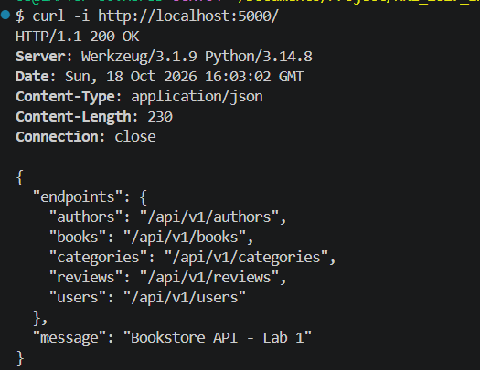
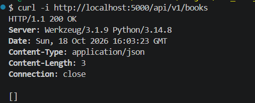

### Test 2 – Tạo Category, Author và User

**POST Category**

```
curl -i -X POST http://localhost:5000/api/v1/categories \
  -H "Content-Type: application/json" \
  -d '{"name":"Technology","slug":"technology"}'
```

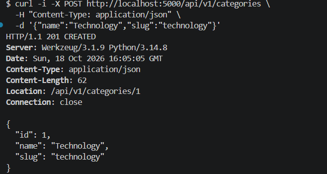

**POST Author**

```
curl -i -X POST http://localhost:5000/api/v1/authors \
  -H "Content-Type: application/json" \
  -d '{"name":"Robert C. Martin","bio":"Author of Clean Code"}'
```

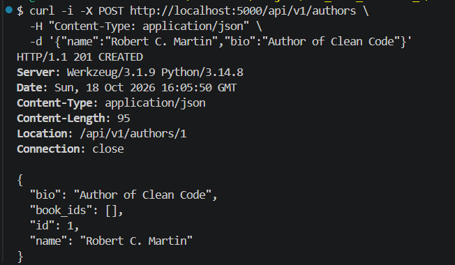

**POST User**

```
curl -i -X POST http://localhost:5000/api/v1/users \
  -H "Content-Type: application/json" \
  -d '{"email":"reader@example.com","display_name":"Reader A"}'
```

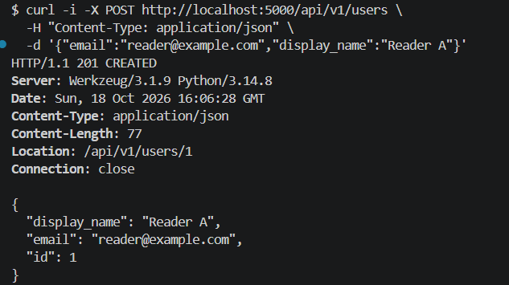

### Test 3 – Tạo và xem Book

**POST Book**

```
curl -i -X POST http://localhost:5000/api/v1/books \
  -H "Content-Type: application/json" \
  -d '{"title":"Clean Code","isbn":"9780132350884","price_vnd":320000,"stock":10,"category_id":1,"author_ids":[1]}'
```

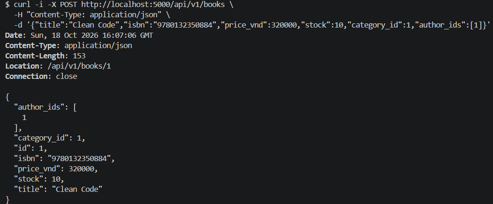

**GET danh sách Book**

```
curl -i http://localhost:5000/api/v1/books
```

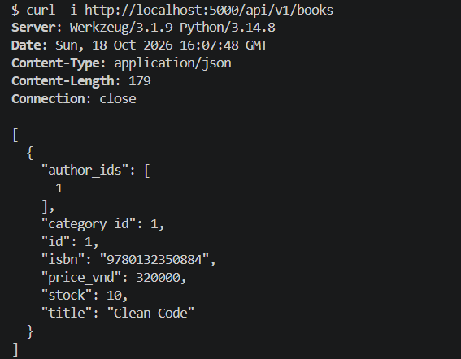

**GET chi tiết Book**

```
curl -i http://localhost:5000/api/v1/books/1
```

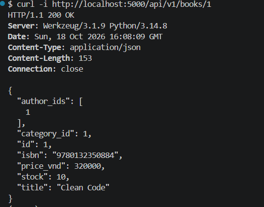

### Test 4 – Cập nhật Book

```
curl -i -X PATCH http://localhost:5000/api/v1/books/1 \
  -H "Content-Type: application/json" \
  -d '{"price_vnd":299000,"stock":8}'
```

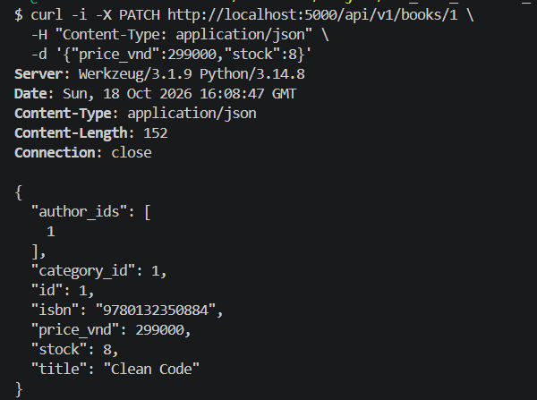

### Test 5 – Tạo và xem Review

**POST Review**

```
curl -i -X POST http://localhost:5000/api/v1/reviews \
  -H "Content-Type: application/json" \
  -d '{"rating":5,"comment":"Very useful book","book_id":1,"user_id":1}'
```

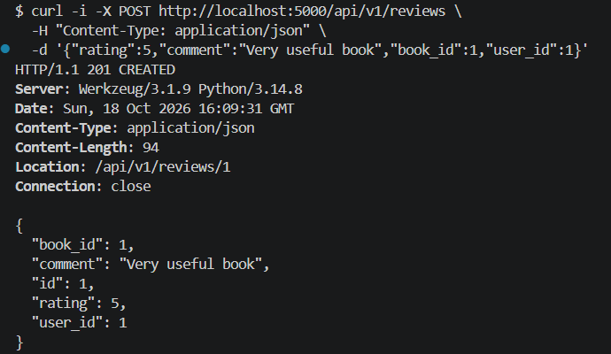

**GET danh sách Review**

```
curl -i http://localhost:5000/api/v1/reviews
```

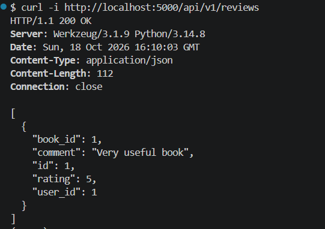

### Test 6 – Xóa Review và Book

**DELETE Review**

```
curl -i -X DELETE http://localhost:5000/api/v1/reviews/1
```

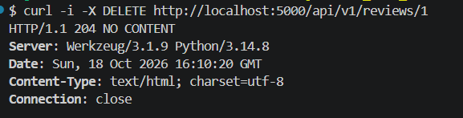

**DELETE Book**

```
curl -i -X DELETE http://localhost:5000/api/v1/books/1
```

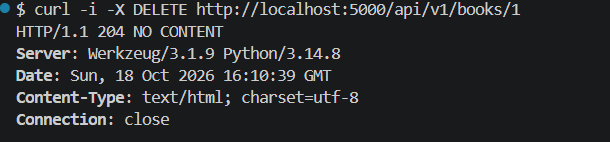

**GET danh sách Book sau khi xóa**

```
curl -i http://localhost:5000/api/v1/books
```

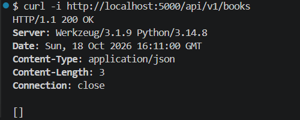