# Lab 2 – Bookstore API: Filter, Sort, Cursor Pagination

Mở rộng **Lab 1**: giữ nguyên 5 entity và CRUD; bổ sung filter, whitelist sort và **composite (sort value, id) cursor** cho `GET /api/v1/books`.

## 1. Danh sách API

| Method | Endpoint | Chức năng |
|---|---|---|
| GET | `/api/v1/books` | Danh sách Book với cursor pagination (mặc định `sort=-id`, `limit=20`) |
| GET | `/api/v1/books?sort=price` | Giá tăng dần, cùng giá sắp theo ID tăng |
| GET | `/api/v1/books?sort=-price` | Giá giảm dần, cùng giá sắp theo ID giảm |
| GET | `/api/v1/books?sort=id` | ID tăng dần |
| GET | `/api/v1/books?sort=-id` | ID giảm dần (mới nhất) |
| GET | `/api/v1/books?category=1` | Lọc theo Category ID |
| GET | `/api/v1/books?limit=2&cursor=...` | Trang tiếp theo (cursor nhận từ `page.next`) |
| GET/POST/PATCH/DELETE | `/api/v1/<resource>` và `/<id>` | CRUD Lab 1: `books`, `authors`, `categories`, `users`, `reviews` |

## 2. Test

### Test 1 – Kiểm tra server, Book ban đầu

```bash
curl -i http://localhost:5000/
curl -i http://localhost:5000/api/v1/books
```

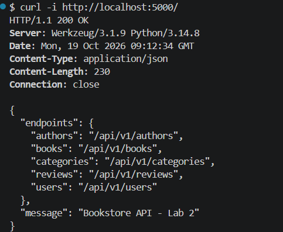
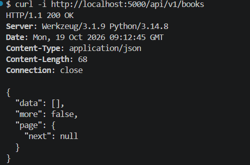

### Test 2 – Tạo dữ liệu để thử sort, filter và pagination

**2.1. Tạo 2 Category:**

```bash
curl -i -X POST http://localhost:5000/api/v1/categories -H 'Content-Type: application/json' -d '{"name":"Technology","slug":"technology"}'
curl -i -X POST http://localhost:5000/api/v1/categories -H 'Content-Type: application/json' -d '{"name":"Fiction","slug":"fiction"}'
```

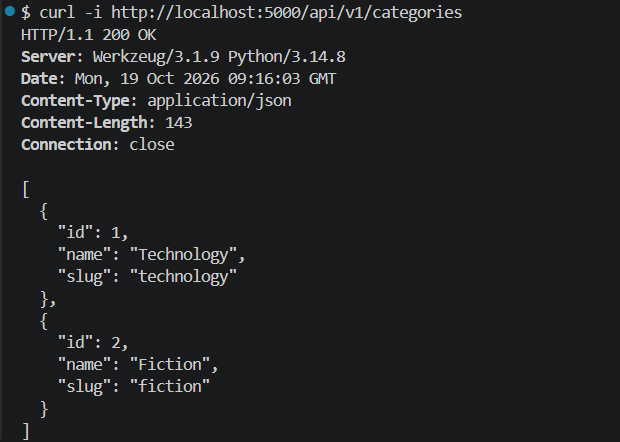

**2.2. Tạo 6 Book:** Một số Book **trùng giá** để kiểm tra tie-break bằng `id`.

```bash
curl -i -X POST http://localhost:5000/api/v1/books -H 'Content-Type: application/json' -d '{"title":"Book A","isbn":"9780000000001","price_vnd":50000,"stock":10,"category_id":1}'
curl -i -X POST http://localhost:5000/api/v1/books -H 'Content-Type: application/json' -d '{"title":"Book B","isbn":"9780000000002","price_vnd":50000,"stock":10,"category_id":1}'
curl -i -X POST http://localhost:5000/api/v1/books -H 'Content-Type: application/json' -d '{"title":"Book C","isbn":"9780000000003","price_vnd":30000,"stock":10,"category_id":1}'
curl -i -X POST http://localhost:5000/api/v1/books -H 'Content-Type: application/json' -d '{"title":"Book D","isbn":"9780000000004","price_vnd":80000,"stock":10,"category_id":1}'
curl -i -X POST http://localhost:5000/api/v1/books -H 'Content-Type: application/json' -d '{"title":"Book E","isbn":"9780000000005","price_vnd":30000,"stock":10,"category_id":2}'
curl -i -X POST http://localhost:5000/api/v1/books -H 'Content-Type: application/json' -d '{"title":"Book F","isbn":"9780000000006","price_vnd":90000,"stock":10,"category_id":2}'
```

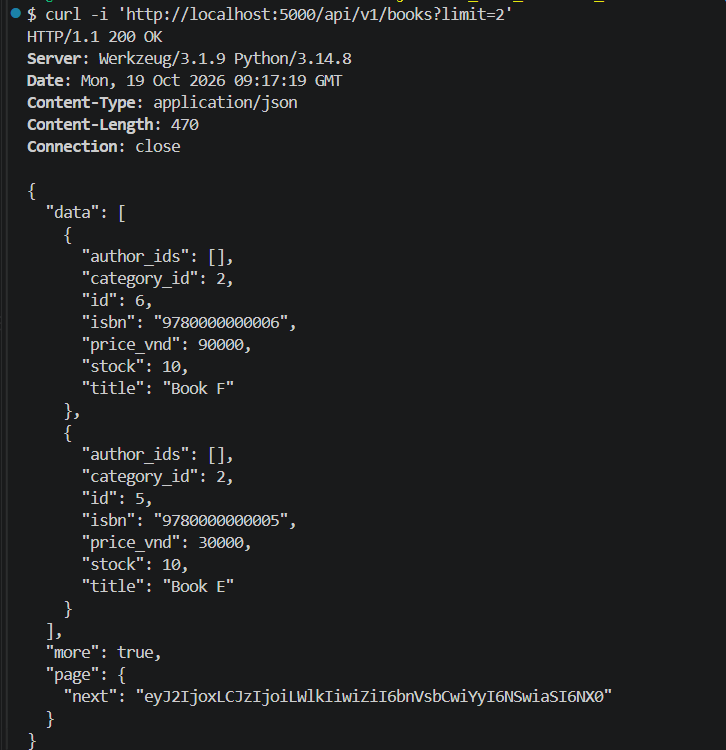

### Test 3 – Sort whitelist

**3.1. Giá tăng dần:**

```bash
curl -i 'http://localhost:5000/api/v1/books?sort=price&limit=5'
```

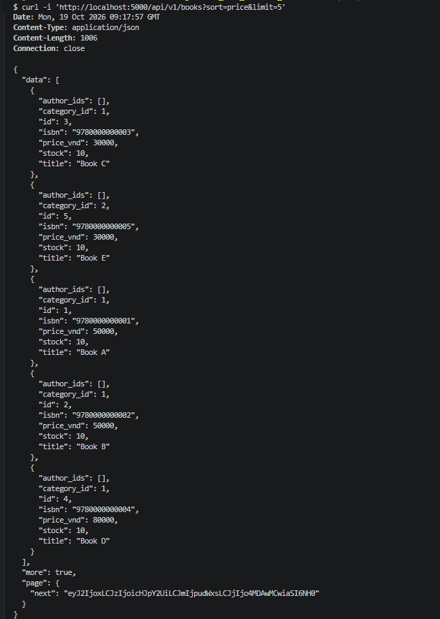

**3.2. Giá giảm dần:**

```bash
curl -i 'http://localhost:5000/api/v1/books?sort=-price&limit=4'
```

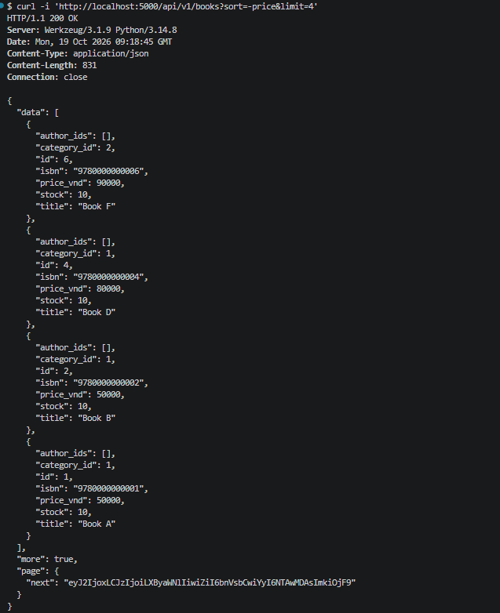

**3.3. ID giảm dần (mặc định):**

```bash
curl -i 'http://localhost:5000/api/v1/books?sort=-id&limit=4'
```

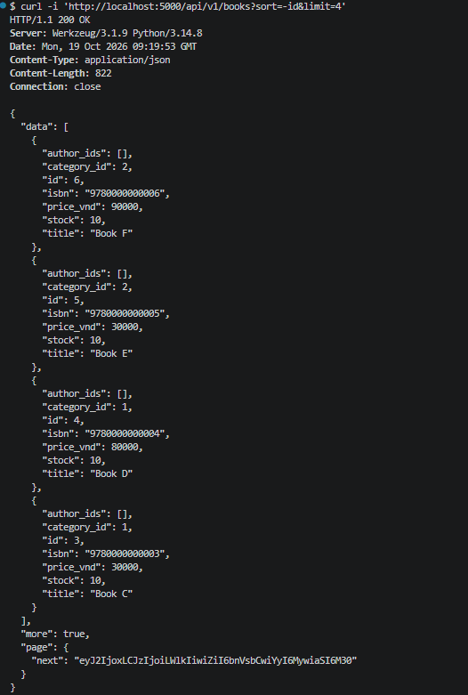

### Test 4 – Filter theo Category

```bash
curl -i 'http://localhost:5000/api/v1/books?category=1&sort=price&limit=4'
```

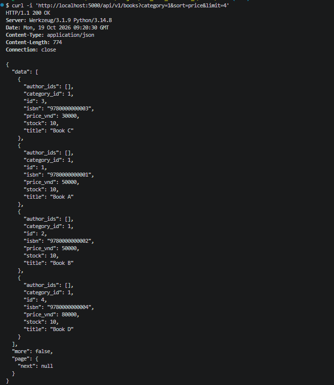

### Test 5 – Composite cursor pagination (kết hợp filter + sort)

**5.1. Trang đầu (`-price`, category 1, limit 2):**

```bash
curl -i 'http://localhost:5000/api/v1/books?category=1&sort=-price&limit=2'
```

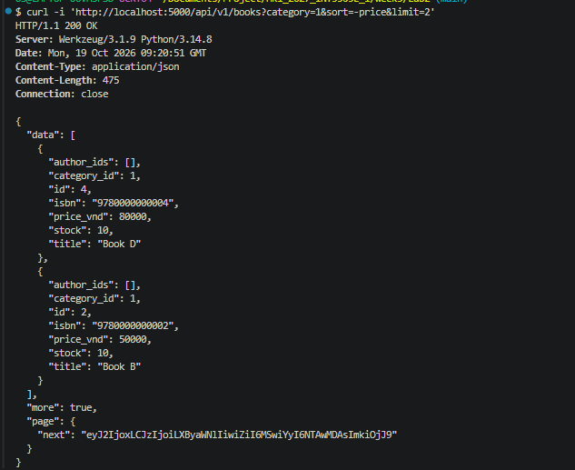

**5.2. Lấy `page.next` và gọi trang kế tiếp**

```bash
CURSOR=$(curl -s 'http://localhost:5000/api/v1/books?category=1&sort=-price&limit=2' | python -c 'import json,sys; print(json.load(sys.stdin)["page"]["next"])')
printf 'Cursor: %s\n' "$CURSOR"
curl -i -G 'http://localhost:5000/api/v1/books' \
  --data-urlencode 'category=1' \
  --data-urlencode 'sort=-price' \
  --data-urlencode 'limit=2' \
  --data-urlencode "cursor=$CURSOR"
```
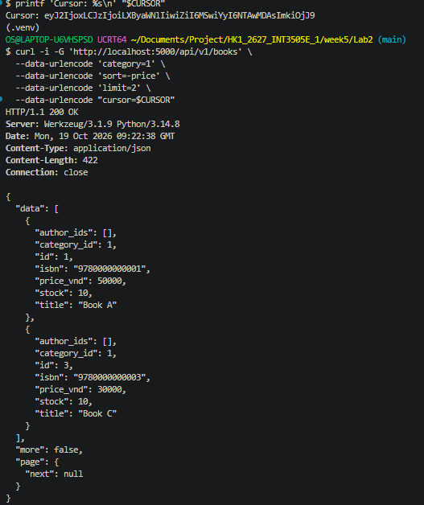

### Test 6 – Validation / Bad requests

**6.1. Sort không thuộc whitelist:**

```bash
curl -i 'http://localhost:5000/api/v1/books?sort=foo'
```

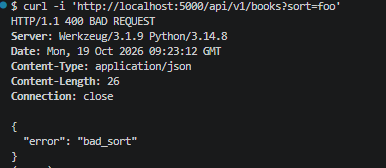

**6.2. Multi-field sort chưa hỗ trợ:**

```bash
curl -i 'http://localhost:5000/api/v1/books?sort=-price,title'
```

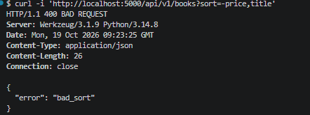

**6.3. Cursor sai định dạng:**

```bash
curl -i 'http://localhost:5000/api/v1/books?cursor=not-a-valid-cursor'
```

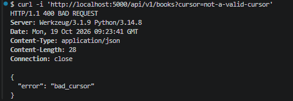

**6.4. Đổi sort khi dùng cursor cũ:** (dùng `$CURSOR` từ Test 5.2)

```bash
curl -i -G 'http://localhost:5000/api/v1/books' \
  --data-urlencode 'category=1' \
  --data-urlencode 'sort=price' \
  --data-urlencode "cursor=$CURSOR"
```

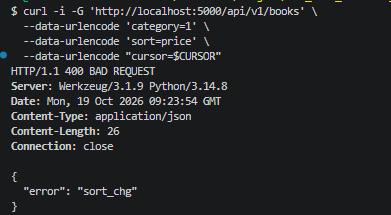

**6.5. Đổi filter khi dùng cursor cũ:**

```bash
curl -i -G 'http://localhost:5000/api/v1/books' \
  --data-urlencode 'category=2' \
  --data-urlencode 'sort=-price' \
  --data-urlencode "cursor=$CURSOR"
```

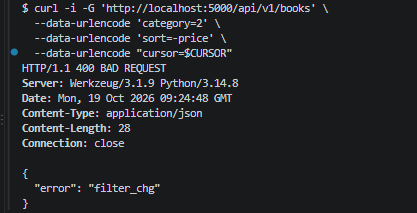