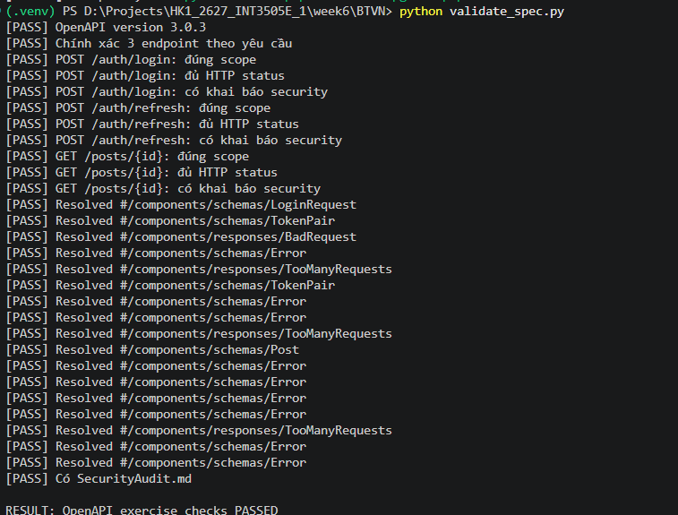
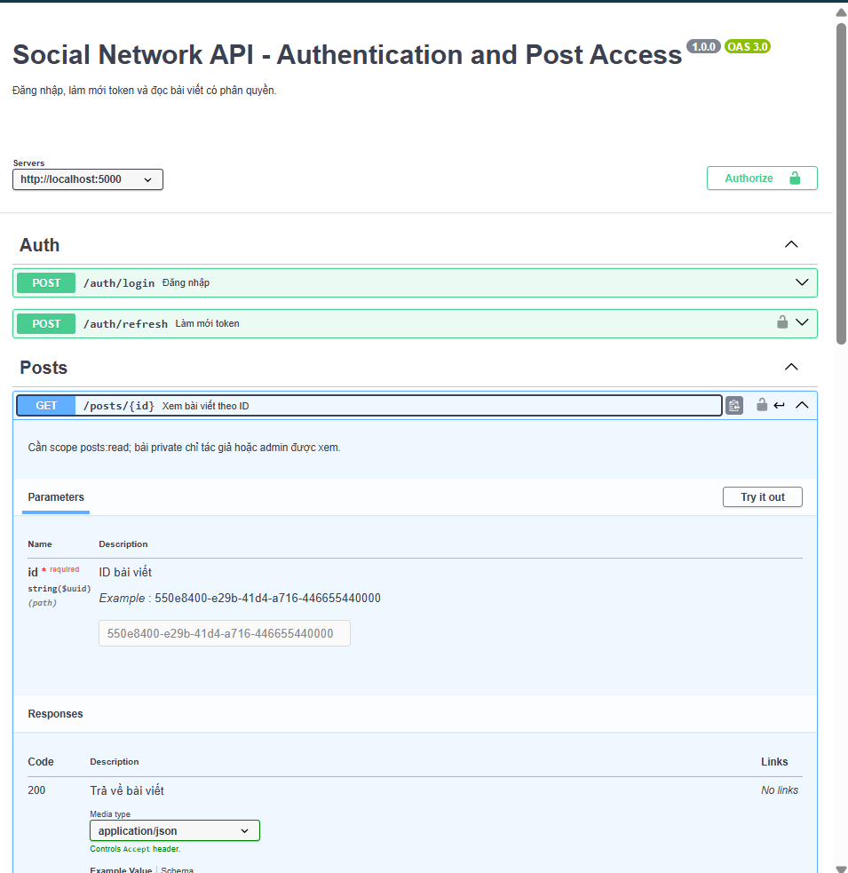
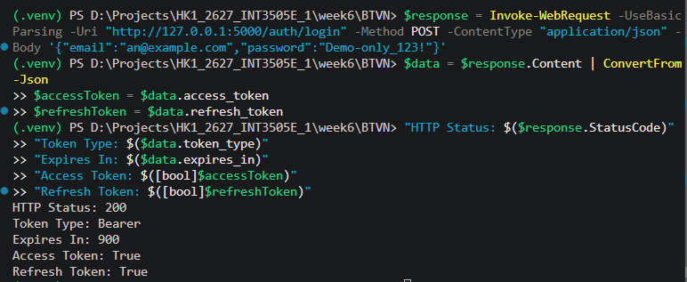
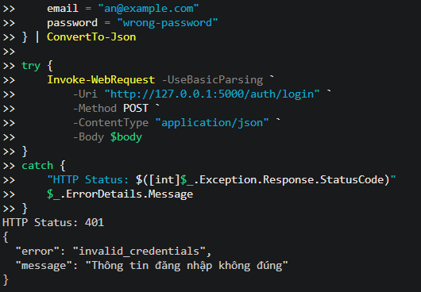
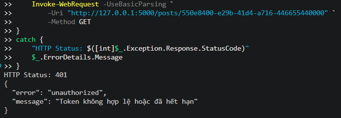
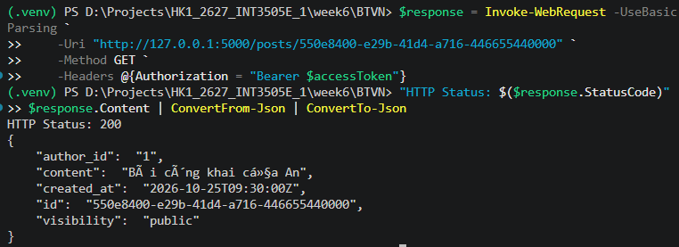
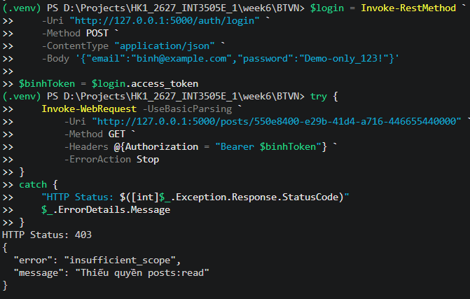
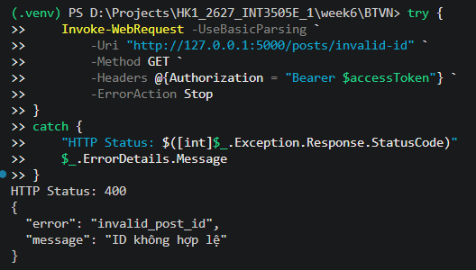
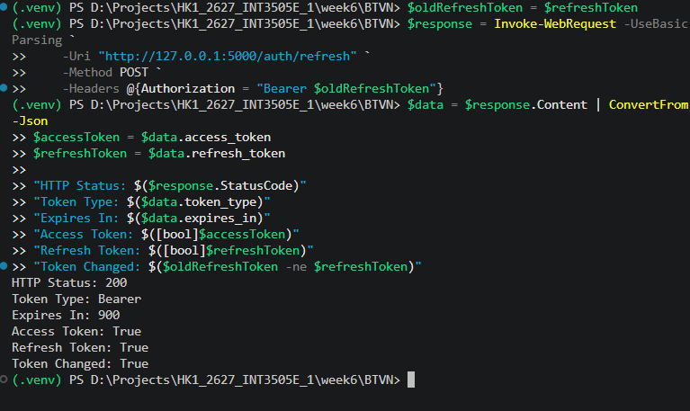

# Bài tập Buổi 06 – Authentication & Authorization

**Domain:** Social Network API

## 1. Danh sách API

| Method | Endpoint | Xác thực / phân quyền | Thành công | Lỗi |
|---|---|---|---|---|
| POST | `/auth/login` | Email và mật khẩu | 200 | 400, 401, 429 |
| POST | `/auth/refresh` | Refresh token hợp lệ | 200 | 401, 403, 429 |
| GET | `/posts/{id}` | Access token, `posts:read`, quyền xem bài viết | 200 | 400, 401, 403, 404, 429 |

**SecurityAudit.md:** Phân tích 8 rủi ro bảo mật và cách khắc phục.

## 2. Scope, lỗi và HTTP status code

| Endpoint | Scope / xác thực | Lỗi có thể xảy ra | Status code |
|---|---|---|---|
| `POST /auth/login` | Không cần scope; xác thực email/mật khẩu | Dữ liệu sai (400), sai thông tin đăng nhập (401), quá nhiều yêu cầu (429) | 200, 400, 401, 429 |
| `POST /auth/refresh` | Không cần scope; yêu cầu refresh token hợp lệ | Token không hợp lệ/hết hạn/đã thu hồi (401), tài khoản bị vô hiệu hóa (403), quá nhiều yêu cầu (429) | 200, 401, 403, 429 |
| `GET /posts/{id}` | Access token và scope `posts:read`; kiểm tra quyền xem bài viết riêng tư | ID sai (400), token không hợp lệ (401), thiếu scope (403), bài viết không tồn tại hoặc không có quyền xem (404), quá nhiều yêu cầu (429) | 200, 400, 401, 403, 404, 429 |

## 3. Kiểm tra OpenAPI

```bash
python validate_spec.py
```



## 3. Swagger



## 4. Kiểm thử API

### 4.1. Đăng nhập thành công – 200



### 4.2. Đăng nhập sai mật khẩu – 401



### 4.3. Truy cập không có token – 401



### 4.4. Xem bài viết hợp lệ – 200



### 4.5. Thiếu scope posts:read – 403



### 4.6. ID bài viết không hợp lệ – 400



### 4.7. Refresh token thành công – 200

