# Buổi 7 – Lab 1: Product API

Product API sử dụng Flask Application Factory, Blueprint, SQLAlchemy 2.x, Marshmallow, Flask-Migrate và SQLite.

## 1. API

| Method | Endpoint | Chức năng |
|---|---|---|
| GET | `/api/v1/products?page=1&size=20` | Danh sách có phân trang |
| GET | `/api/v1/products/{id}` | Xem chi tiết sản phẩm |
| POST | `/api/v1/products` | Tạo sản phẩm |
| POST | `/api/v1/products/{id}/reserve` | Đặt trước, trừ tồn kho |
| PATCH | `/api/v1/products/{id}` | Cập nhật một phần |
| DELETE | `/api/v1/products/{id}` | Xóa mềm |

**Ràng buộc:** SKU duy nhất, 3–32 ký tự; tên 1–255 ký tự; giá và tồn kho không âm; sản phẩm đã xóa mềm không xuất hiện trong GET mặc định. Lỗi 404/409/422 trả JSON dạng `{"error":"...","detail":"..."}`.

## 2. Cài đặt

```bash
python -m venv .venv
source .venv/Scripts/activate
python -m pip install -r requirements.txt
```

## 3. Khởi tạo database

Project đã có thư mục `migrations/`. Chạy:

```bash
python -m flask --app app db upgrade
```

## 4. Chạy server

```bash
python -m flask --app app run --debug
```

Địa chỉ: `http://127.0.0.1:5000`.

## 5. Kiểm thử API

### 5.1. Tạo sản phẩm – POST (201)

```bash
curl -i -X POST http://127.0.0.1:5000/api/v1/products \
  -H "Content-Type: application/json" \
  -d '{"sku":"SP001","name":"Ban phim co","price_cents":250000,"qty_in_stock":10}'
```

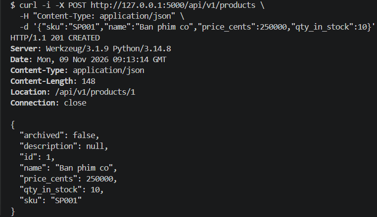

### 5.2. Lấy danh sách sản phẩm – GET (200)

```bash
curl -i "http://127.0.0.1:5000/api/v1/products?page=1&size=20"
```

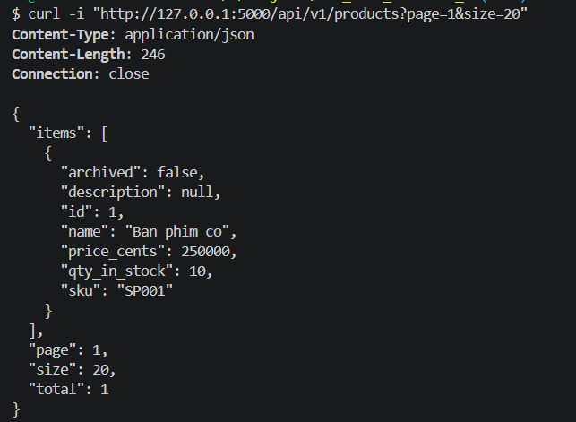

### 5.3. Lấy chi tiết sản phẩm – GET (200)

```bash
curl -i http://127.0.0.1:5000/api/v1/products/1
```

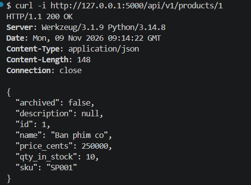

### 5.4. Cập nhật sản phẩm – PATCH (200)

```bash
curl -i -X PATCH http://127.0.0.1:5000/api/v1/products/1 \
  -H "Content-Type: application/json" \
  -d '{"name":"Ban phim co RGB","price_cents":350000}'
```

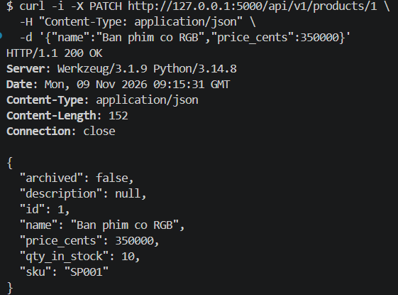

### 5.5. Đặt trước sản phẩm – POST reserve (200)

```bash
curl -i -X POST http://127.0.0.1:5000/api/v1/products/1/reserve \
  -H "Content-Type: application/json" \
  -d '{"qty":3}'
```

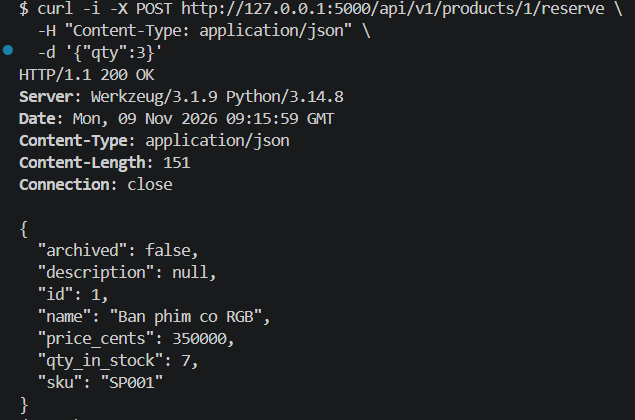

### 5.6. Xóa mềm sản phẩm – DELETE (204)

```bash
curl -i -X DELETE http://127.0.0.1:5000/api/v1/products/1
```

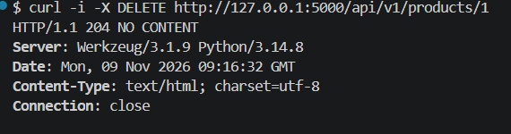

### 5.7. Truy cập sản phẩm đã xóa – GET (404)

```bash
curl -i http://127.0.0.1:5000/api/v1/products/1
```

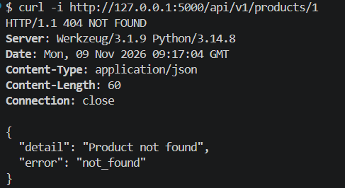

### 5.8. Tạo sản phẩm trùng SKU – POST (409)

```bash
curl -i -X POST http://127.0.0.1:5000/api/v1/products \
  -H "Content-Type: application/json" \
  -d '{"sku":"SP001","name":"Chuot gaming","price_cents":150000,"qty_in_stock":5}'
```

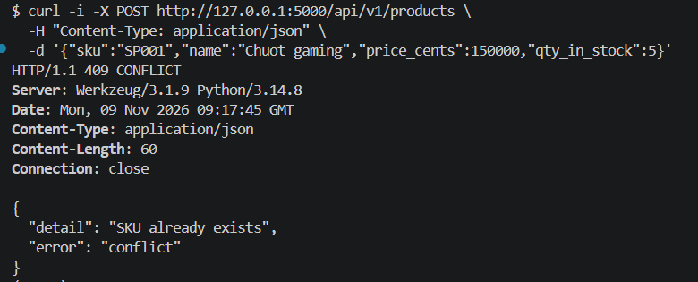

### 5.9. Dữ liệu không hợp lệ – POST (422)

```bash
curl -i -X POST http://127.0.0.1:5000/api/v1/products \
  -H "Content-Type: application/json" \
  -d '{"sku":"AB","name":"Ban phim","price_cents":-100,"qty_in_stock":-5}'
```

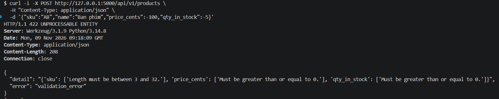

## Kiểm thử Order API

### 10. Tạo sản phẩm cho đơn hàng – 201

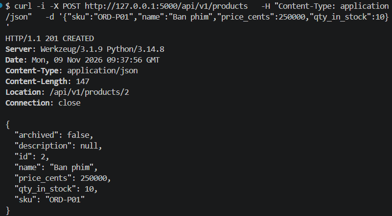

### 11. Tạo đơn hàng nhiều sản phẩm – 201

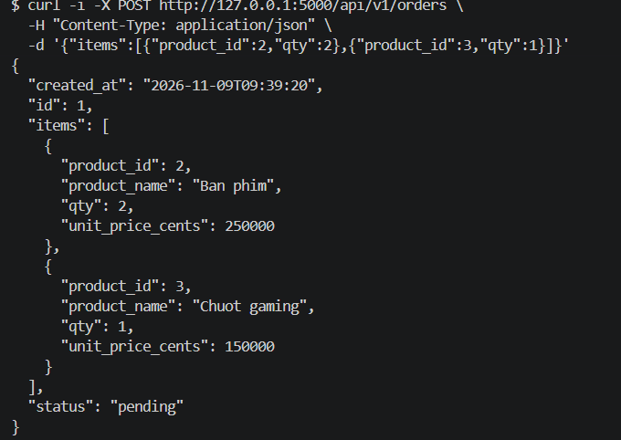

### 12. Lấy chi tiết đơn hàng – 200

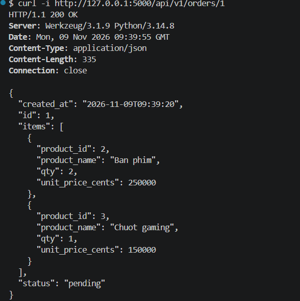

### 13. Đơn hàng không tồn tại – 404

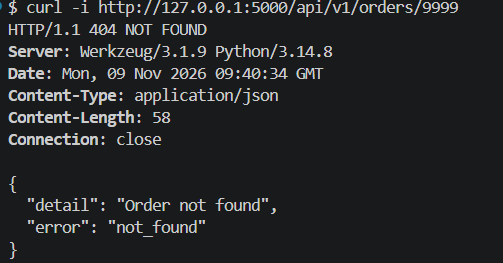

### 14. Số lượng không hợp lệ – 422

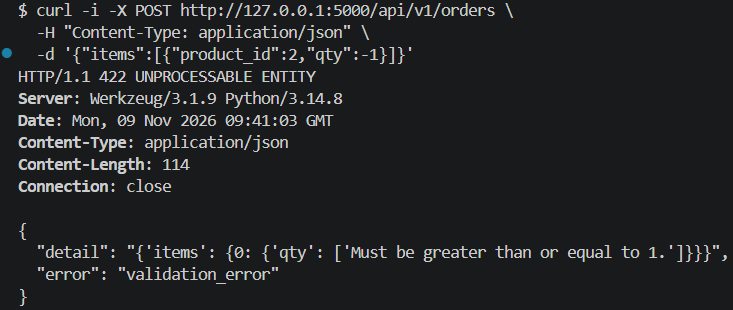


## Kiểm thử tự động (Pytest)

Kiểm thử POST tạo đơn hàng và GET sử dụng eager loading.

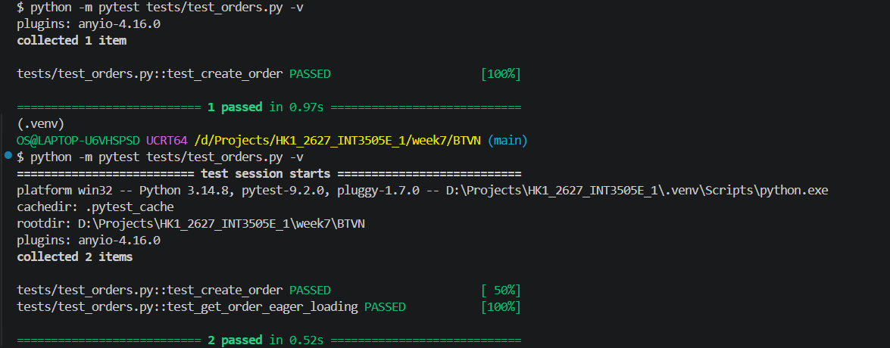