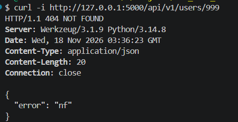

# Lab 1 – URI Path Versioning với Flask Blueprint

## 1. Mục tiêu

Triển khai API Versioning bằng URI Path với Flask Blueprint, cho phép hai phiên bản API hoạt động song song:

- **v1:** Trả về `full_name`.
- **v2:** Trả về `first_name` và `last_name`.
- Cả hai phiên bản sử dụng chung nguồn dữ liệu.

## 2. Kiểm thử và kết quả

### 2.1. Kiểm thử API v1 và v2

```bash
curl -i http://127.0.0.1:5000/api/v1/users/1
```


```bash
curl -i http://127.0.0.1:5000/api/v2/users/1
```


### 4.2. Kiểm thử trường hợp không tìm thấy người dùng

```bash
curl -i http://127.0.0.1:5000/api/v1/users/999
```

