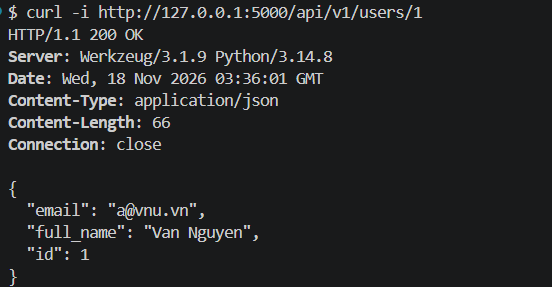
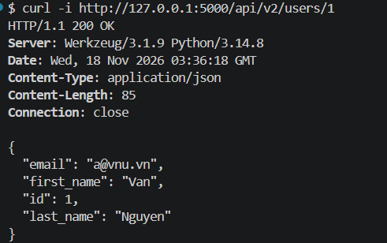
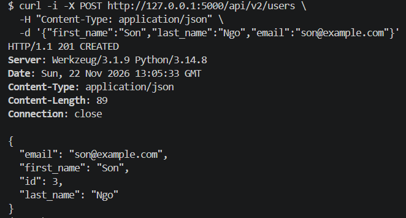
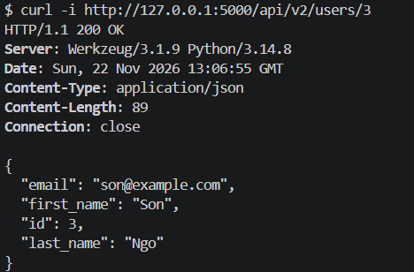
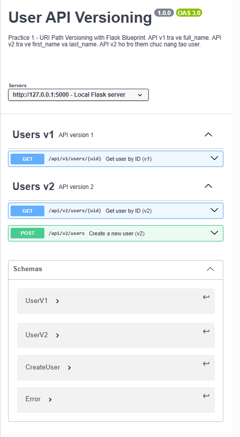
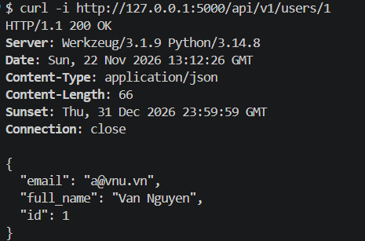

# Lab 1 – URI Path Versioning với Flask Blueprint

## 1. Mục tiêu

Triển khai API Versioning bằng URI Path với Flask Blueprint, cho phép hai phiên bản API hoạt động song song:

- **v1:** Trả về `full_name`.
- **v2:** Trả về `first_name` và `last_name`.
- Cả hai phiên bản sử dụng chung nguồn dữ liệu.

**Phần mở rộng:**
- Thêm `POST /api/v2/users` cho v2.
- Viết OpenAPI Specification.
- Thêm Sunset response header cho v1.

## 2. Kiểm thử và kết quả

### 2.1. Kiểm thử API v1

```bash
curl -i http://127.0.0.1:5000/api/v1/users/1
```

**Kết quả:** HTTP 200 OK, response chứa `full_name`.



### 2.2. Kiểm thử API v2

```bash
curl -i http://127.0.0.1:5000/api/v2/users/1
```

**Kết quả:** HTTP 200 OK, response chứa `first_name` và `last_name`.



### 2.3. Kiểm thử trường hợp không tìm thấy người dùng

```bash
curl -i http://127.0.0.1:5000/api/v1/users/999
```

**Kết quả:** HTTP 404 NOT FOUND.


## 3. Mở rộng 1 – Thêm POST /users cho v2

Bổ sung chức năng tạo người dùng thông qua endpoint `POST /api/v2/users`. Dữ liệu được lưu vào dictionary `USERS` dùng chung.

### 3.1. Kiểm thử tạo người dùng

```bash
curl -i -X POST http://127.0.0.1:5000/api/v2/users \
  -H "Content-Type: application/json" \
  -d '{"first_name":"Son","last_name":"Ngo","email":"son@example.com"}'
```

**Kết quả:** HTTP 201 CREATED, tạo thành công người dùng có ID 3.



### 3.2. Kiểm thử lấy thông tin người dùng vừa tạo

```bash
curl -i http://127.0.0.1:5000/api/v2/users/3
```

**Kết quả:** HTTP 200 OK, trả về đúng thông tin người dùng vừa tạo.



## 4. Mở rộng 2 – Viết OpenAPI Specification

Tạo file `openapi.yaml` theo chuẩn OpenAPI 3.0.3 để mô tả:

- `GET /api/v1/users/{uid}`
- `GET /api/v2/users/{uid}`
- `POST /api/v2/users`

Đặc tả bao gồm request, response, HTTP status code và các schema `UserV1`, `UserV2`, `CreateUser`, `Error`.

### 4.1. Kiểm tra bằng Swagger Editor

Sử dụng [Swagger Editor](https://editor.swagger.io/) để kiểm tra và hiển thị tài liệu API.

**Kết quả:** Hiển thị đầy đủ 3 endpoint và 4 schema.



## 5. Mở rộng 3 – Thêm Sunset response header cho v1

Sử dụng `@bp.after_request` để bổ sung header `Sunset` cho API v1, thông báo ngày dự kiến ngừng hỗ trợ là `31/12/2026 23:59:59 GMT`.

### 5.1. Kiểm thử Sunset header

```bash
curl -i http://127.0.0.1:5000/api/v1/users/1
```

**Kết quả:** HTTP 200 OK, có header `Sunset` với ngày đã cấu hình. Response JSON không thay đổi.

