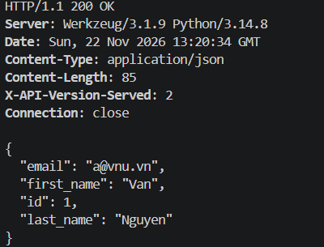
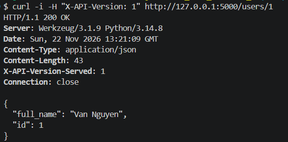
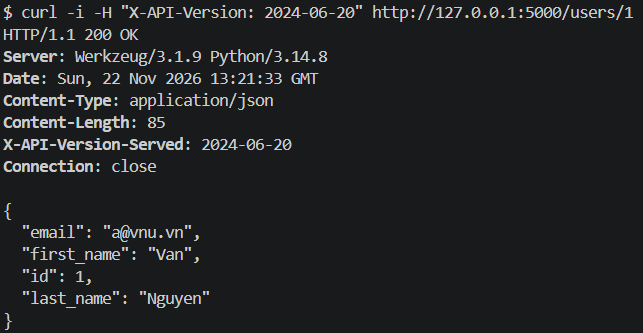
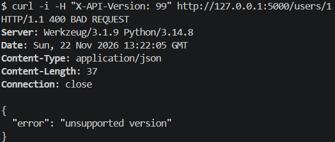

# Lab 2 – Header Versioning với Flask Decorator

## 1. Mục tiêu

Triển khai API Versioning thông qua HTTP header bằng Flask Decorator `@api_version`.

- Sử dụng chung endpoint `GET /users/{uid}` cho các phiên bản API.
- Client lựa chọn phiên bản bằng header `X-API-Version`.
- Mặc định sử dụng v2 nếu không truyền header.
- Response trả thêm header `X-API-Version-Served`.
- Trả HTTP 400 nếu phiên bản không được hỗ trợ.

Các phiên bản được hỗ trợ: `1`, `2` và `2024-06-20`.

## 2. Kiểm thử và kết quả

Khởi động ứng dụng:

```bash
python app.py
```

Thực hiện kiểm thử bằng Git Bash.

### 2.1. Kiểm thử phiên bản mặc định (v2)

```bash
curl -i http://127.0.0.1:5000/users/1
```

**Kết quả:** HTTP 200 OK, response theo schema v2 và header `X-API-Version-Served: 2`.



### 2.2. Kiểm thử Header Versioning v1

```bash
curl -i -H "X-API-Version: 1" http://127.0.0.1:5000/users/1
```

**Kết quả:** HTTP 200 OK, response chứa `full_name` và header `X-API-Version-Served: 1`.



### 2.3. Kiểm thử Date-based Versioning

```bash
curl -i -H "X-API-Version: 2024-06-20" http://127.0.0.1:5000/users/1
```

**Kết quả:** HTTP 200 OK, response theo schema v2 và header `X-API-Version-Served: 2024-06-20`.



### 2.4. Kiểm thử phiên bản không được hỗ trợ

```bash
curl -i -H "X-API-Version: 99" http://127.0.0.1:5000/users/1
```

**Kết quả:** HTTP 400 BAD REQUEST, trả về thông báo `unsupported version`.

