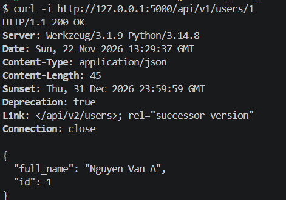
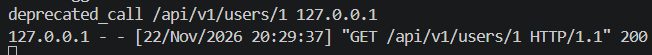
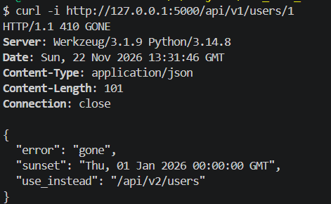

# Lab 3 – Sunset Middleware với Flask Decorator

## 1. Mục tiêu

Triển khai cơ chế API Deprecation và Sunset bằng decorator `@deprecate_at` trong Flask.

- Trước ngày Sunset: API vẫn hoạt động, trả HTTP 200 kèm các header cảnh báo.
- Sau ngày Sunset: API trả HTTP 410 Gone.
- Ghi warning log khi client gọi API deprecated.
- Cung cấp đường dẫn API thay thế cho client.

## 2. Kiểm thử và kết quả

Khởi động ứng dụng:

```bash
python app.py
```

Các lệnh kiểm thử được thực hiện bằng Git Bash.

### 2.1. Kiểm thử trước ngày Sunset

Cấu hình ngày Sunset: `31/12/2026 23:59:59 GMT`.

```bash
curl -i http://127.0.0.1:5000/api/v1/users/1
```

**Kết quả:** HTTP 200 OK, response có đầy đủ các header `Sunset`, `Deprecation: true` và `Link` trỏ sang API v2.



### 2.2. Kiểm tra Warning Log

Khi client gọi API v1 trước ngày Sunset, decorator ghi lại cảnh báo `deprecated_call` trên terminal Flask.

**Kết quả:** Server ghi nhận đường dẫn API và địa chỉ IP client.



### 2.3. Kiểm thử sau ngày Sunset

Tạm thời thay đổi `V1_SUNSET` thành `01/01/2026 00:00:00 GMT` để mô phỏng thời điểm API đã ngừng hỗ trợ.

```bash
curl -i http://127.0.0.1:5000/api/v1/users/1
```

**Kết quả:** HTTP 410 GONE, response chứa `error: gone`, thời điểm Sunset và đường dẫn API thay thế.



Sau kiểm thử, khôi phục `V1_SUNSET` về `31/12/2026 23:59:59 GMT`. API tiếp tục trả HTTP 200 và các header cảnh báo như ban đầu.