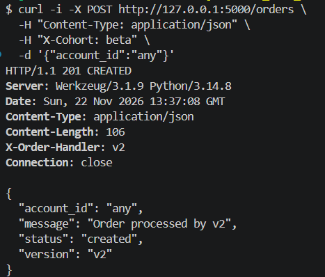
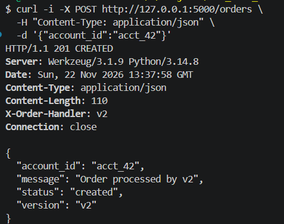
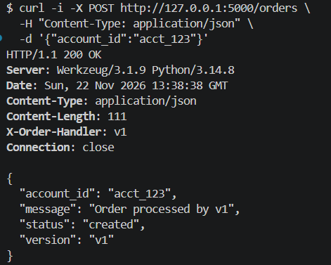
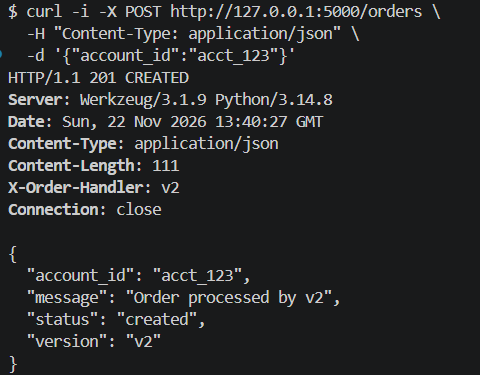

# Lab 4 – Blue-Green Routing với Flask

## 1. Mục tiêu

Triển khai Blue-Green Routing cho endpoint `POST /orders`, cho phép điều hướng request đến handler v1 hoặc v2.

Gateway lựa chọn phiên bản theo ba quy tắc ưu tiên:

- **Cohort:** Header `X-Cohort: beta` hoặc `internal` được chuyển đến v2.
- **Allow-list:** Các account `acct_42`, `acct_99` luôn sử dụng v2.
- **Hash Bucket:** Account thông thường được phân phối theo tỷ lệ `V2_PERCENT`.

Response có header `X-Order-Handler` để xác định phiên bản xử lý.

## 2. Kiểm thử và kết quả

Khởi động ứng dụng:

```bash
python app.py
```

Thực hiện kiểm thử bằng Git Bash.

### 2.1. Kiểm thử Cohort Beta

```bash
curl -i -X POST http://127.0.0.1:5000/orders \
  -H "Content-Type: application/json" \
  -H "X-Cohort: beta" \
  -d '{"account_id":"any"}'
```

**Kết quả:** HTTP 201 CREATED, `X-Order-Handler: v2`. Request được chuyển đến v2 nhờ header `X-Cohort: beta`.



### 2.2. Kiểm thử Account Allow-list

```bash
curl -i -X POST http://127.0.0.1:5000/orders \
  -H "Content-Type: application/json" \
  -d '{"account_id":"acct_42"}'
```

**Kết quả:** HTTP 201 CREATED, `X-Order-Handler: v2`. Account thuộc allow-list được chuyển đến v2.



### 2.3. Kiểm thử Hash Bucket với rollout 5%

Cấu hình `V2_PERCENT = 5`.

```bash
curl -i -X POST http://127.0.0.1:5000/orders \
  -H "Content-Type: application/json" \
  -d '{"account_id":"acct_123"}'
```

**Kết quả:** HTTP 200 OK, `X-Order-Handler: v1`. Account `acct_123` được phân vào nhóm sử dụng v1.



### 2.4. Kiểm thử rollout 100%

Thay đổi cấu hình `V2_PERCENT = 100`, sau đó gửi lại request với cùng account.

```bash
curl -i -X POST http://127.0.0.1:5000/orders \
  -H "Content-Type: application/json" \
  -d '{"account_id":"acct_123"}'
```

**Kết quả:** HTTP 201 CREATED, `X-Order-Handler: v2`. Account trước đó sử dụng v1 đã chuyển sang v2.

